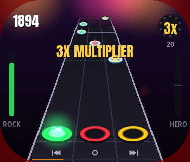

# Q2 Hero

A guitar game for the Shanling Q2 under [Q2 Pod](https://github.com/DiamondBond/q2-pod), played to
the music on your own card, as a full-screen **card game** in Library → Games. Pick a song (listed by the
title in its tags, in any script the Q2 shows), pick Easy, Medium, Hard or Expert, and hit the notes as they come down three lanes: **Prev**,
**Centre** and **Next**, or tap the lanes. The wheel is left alone while playing, since the
buttons sit on it; the volume is the pause menu's speaker, where the wheel sets the Q2's volume
through Q2 Pod (`/tmp/q2-hero.volume`).



There are no song packs. The first time a song is picked, the Q2's own ffmpeg decodes it and
Q2 Hero listens to it once, finding its tempo, its beats and what sounds on and between them. The
notes are charted from that, the way hand-made rhythm game maps are, for each difficulty, and kept
on the card so the song opens at once after that.

The player's guide (install, controls, scoring, options) is [card/README.txt](card/README.txt),
copied into the card folder as `README.txt`.

## How a song is charted

`src/analyze.c` listens and hears the song's parts apart; `src/chart.c` writes each difficulty's
notes from them.

1. **Held and struck.** Every 128 samples (11.6 ms), a 512-point spectrum (two frames to one
   complex FFT) is split by median filtering (Fitzgerald 2010): a level that holds over 120 ms is a
   note's, one that holds across 230 Hz is a drum's. The held part's rise in the bass and the middle
   is where notes start; the struck part's rise, low, middle and high, is the kick, snare and hats.
   The medians run on sorted windows updated in place, so the split costs little.
2. **Pitch.** The song is heard in stereo. Every 46 ms, a 2048-point spectrum of the sum and one
   of the difference (as one complex FFT) give each bin how much of it is panned to the centre,
   where a voice or a lead sits, and what is spread to the sides (guitars, keys, reverb) is turned
   down; a mono song is heard as it is. The spectrum, flattened so only its peaks are left, scores
   every pitch in the tune's range (A2 to F6, a third of a semitone apart) by the sum of its
   harmonics, allowing for vibrato, favouring pitches rich in harmonics and a little higher (a
   voice over a soft chord pad), and an octave up when that explains it as well. The same for the
   bass, E1 to C3.
3. **Notes.** A tune or bass note starts where its pitch is clear and the held part rises (a
   slowly swelling pad never does), lasts while its own pitch still sounds though something else is
   louder for a moment, and splits on a fresh attack at the same pitch (a repeated note) only if
   that pitch's own strength dips and swells again: an attack in the accompaniment under a held
   note doesn't split it. A drum's leak into the held part neither starts nor splits one. A tune note that is the bass heard an
   octave up is dropped; an octave slip up and straight back is put right.
4. **Beat.** The tempo comes from the kick, snare and hats alone: their onset curve's
   autocorrelation, scored at the beat, its double and its bar (2x, 4x), leaning toward 110 BPM.
   The beats come from dynamic programming over the kick and snare (Ellis 2007). Then what falls
   between the beats decides the grid: under 100 BPM with hits on the quarters (and more there than
   on the thirds, which would only be the other instruments), it is a half-time feel and the beats
   are found again twice as fast; hits on the thirds and not the quarters are a swing, charted on
   thirds. Then, as a charter sets one BPM and one offset for a song, the beats are tested against
   one steady tempo: each tempo within 0.6% of theirs, scored by how many beats fall within 12 ms of
   its grid at its best phase, refined on those within 30 ms. If 55% of the beats keep to it
   within 30 ms, and 40% in each third of the song, its grid replaces them: beats that follow the
   drums one by one get pulled off by syncopation, by tens of ms. A song whose tempo drifts keeps
   the beats found. A hit is timed 24.5 ms before its rise peaks, near its attack's start, as
   players hear it (measured against the maps).
5. **Charting like a mapper** (`src/chart.c`). Eleven osu!mania maps that play well, studied with
   their songs (`test/maps.py`), are built on the beat, not on onsets: 92% of beats carry a note
   (60-65% of them chords), 77% of half-beats, 11-17% of quarter-beats as fills where the music is
   busy; about 70% of bars repeat an earlier bar's rhythm; and the lanes move in shapes, following
   the tune's pitch no more often than not. So every quarter of every beat is a slot, scored by a
   logistic model fitted to those maps from its place (beat, half, quarter) and what sounds there
   (the held and struck rises and the loudness, each to the song's own level), one model for a
   note and one for a chord. Each difficulty keeps its share of the best beats, half-beats and
   quarter-beats (judged half against the slots around them, so a quieter verse keeps its pulse),
   a fill only where something sounds, no two notes nearer than its least gap and no more than
   its notes a second; chords go on its best beats. A bar that sounds like an earlier one takes
   that bar's rhythm. Slots where the tune begins a note are preferred a little (the maps follow
   the drums; a player hears the tune). Lanes come from shapes, one a bar (a bounce, a zigzag, an
   anchor on Centre, stairs): the shape, or its mirror, whose moves best follow the tune's (up to
   the right, down to the left, a repeat in place); a repeated bar plays its shape again, mirrored
   unless the tune says otherwise.
6. **Held notes.** A note where the tune (or the bass, where the tune rests) holds for 3/4 of a beat
   or more, or where a held sound begins that the tune doesn't follow (strings, a pad): a partial
   that is new at the note (a peak 7 dB over its neighbourhood, 3.5 dB over the same bins just
   before) and stays within 6 dB at its pitch, its most prominent one's length if 1.5 beats or more.
   Scored by how long it holds and how quiet the next beat is (what the maps' held notes follow), up
   to a share of each difficulty's notes: Easy 60%, Medium 48%, Hard 30%, Expert 25% (they rarely
   reach it). On Easy and Medium a strongly held note takes the notes under it, and a clear sung
   note held 1.5 beats or more that begins off the beat gets a note in place of the beat it
   anticipates. On Hard and Expert a held Prev or Next note keeps single taps under it, on the other
   side, a third of a second apart; it ends before it would cost more than one tap. A bar like an
   earlier one holds what that bar held, where its own notes hold too.
7. **The lead.** Each bar's lead is the voice where one sings (two of the bar's tune notes waver
   in pitch, as a voice's vibrato and slides do: on the mixes with a known voice, sung notes
   wavered a median 0.09 semitones, plucked and strummed ones and strings 0.02-0.03), else the
   tune's instrument, else the bass; a bar with none is charted by the drums as the maps are. In a
   bar with a lead, every note of it at the places a difficulty plays (Easy the beat, Medium the
   half-beat, Hard and Expert the quarter) is kept, a held note stops for it and a repeated bar
   doesn't copy over it; of the other places, a share keeps the pulse (Easy 35% of the beats,
   Expert 56% of the beats and 35% of the half-beats).
8. **Soft bars**, the song's quietest third, play gently: no zigzag across the buttons, no chords.
9. **Playable on three buttons.** A Q2 button is pressed again comfortably about four times a
   second, not the ten of a keyboard: no button is pressed again within 0.40 / 0.30 / 0.25 / 0.22 s
   (Easy to Expert; a chord presses both sides), or a third time within half a second of each press
   before; Centre not just after a side; no second holds more than 2.5 / 3.5 / 5 / 6 notes. A lane
   that isn't free goes to the next in the bar's shape, or the note goes.

Q2 Pod's own rules shape the lanes. Q2 Pod drops a Centre press that begins while Prev or Next is
held (`chord_gate`, as a slip of the thumb), so the only chord is Prev + Next, a held note has no
other notes inside it, and a Centre note comes a little after a side note. Centre held 5 s opens
the Shut Down prompt, so a held Centre note lasts 1.5 s at most.

**Checked** (`test/run.sh`) on test songs with known hits (`test/mksongs.py`): three band songs
(120, 156 and a 97 BPM shuffle), a tune over a walking bass and a chord pad (110), a riff of
sixteenths (140) and a sung ballad over soft drums (80). The tempo is found within 0.3% and the
beats and hits within a few ms; every difficulty's notes sit on real hits (at least 85%) and on the
grid (95%), Easy's on the beat; no lane takes over 60% of the notes; and bars repeat.

**Against the maps** (`test/maps.py SONGS_DIR`, an unpacked osu! Songs folder; nothing of them is
kept here). Notes that sit on a map's note, and the maps' notes Expert plays:

| | Easy | Medium | Hard | Expert | Map notes covered |
|---|---|---|---|---|---|
| 1.2 (onsets and pitch) | 63% | 59% | 59% | 56% | 29% |
| 1.3 (the grid and the model) | 94% | 92% | 89% | 86% | 70% |

In 1.6, with the button limits and many more held notes, notes on a map note are Easy 87%, Medium
91%, Hard 92%, Expert 88%, at 0.9, 1.6, 2.7 and 3.3 notes a second; Expert covers half the maps'
rows (the maps, made for keyboards, press one key again as fast as ten times a second).

**Timing against the maps** (Expert's notes that sit on a map note, against that note): 1.5 had a
median error of 8.9 ms, a mean of +7 ms and 11% more than 25 ms off; 1.6, with one steady tempo
where a song keeps to one (nine of the eleven), 2.7 ms, +0.5 ms and 3%.

**Against a known tune** (`test/mktunes.py` makes six mixes: a sung line with formants, vibrato
and glides in the centre, against plucked arpeggios and strums in its own range panned left and
right, a wide pad, bass and drums, and in the second half a bowed string section holding long notes;
`test/tunes.py` scores them):

| | Tune notes found right | Their length | Held (Easy / Expert) | Holds on something held | Long sung notes held (Hard / Expert) | String notes held (Easy-Expert) |
|---|---|---|---|---|---|---|
| 1.3 | 38% | 0.75 of true | — | — | — | — |
| 1.4 | 67% | 1.03 of true | 33% / 8% | 59-82% | 26% / 21% | 21%, 19%, 9%, 7% |
| 1.5 | 67% | 1.03 of true | 56% / 27% | 61-81% | 42% / 42% | 34%, 37%, 33%, 27% |

Hard and Expert chart 75-77% of the tune's notes (1.4: 94-98%), the cost of the button limits.
In 1.7, with the lead first, the share of the sung notes charted went from 34/48/72/77% (Easy to
Expert) to 42/60/78/77%, and of the chart's notes on a sung note, on Medium, from 49% to 55%.

The model was fitted on these eleven songs; fitted on ten and tried on the one left out, each in
turn, Expert's notes sat on a map note 83-88% of the time. Densities are 1.2, 2.3, 3.5 and 4.5
notes a second (the maps, for four or more keys: 4.5-6.6). Ten of the eleven tempos are the map's;
one (207 BPM) is found at half. A 4-minute song takes about 1 s to listen to on a desktop, about as
long as ffmpeg takes to decode it.

## Timing

Everything is timed by the music as it is heard. After each write to ALSA, `snd_pcm_delay` says
how many frames are still ahead of the speaker, and a short history of which music frame each
written chunk began with turns that into the music frame heard now (`src/sound.c`). Pauses, and a
decoder that falls behind, don't move the music, so they don't move the clock. Key presses come in
on a thread that stamps each datagram as it arrives, so a press is judged when it was made, not at
the next frame. The player's Timing offset (set by hand or by **Check timing**, which plays clicks
on the same clock) is kept for each output: the jack, Bluetooth and USB.

## Building

```sh
./build.sh       # build/q2-hero and dist/.hero (copy .hero to the card's root)
test/run.sh      # host tests (clang, python3 with numpy and Pillow, ffmpeg)
```

A release is a zip of the card folder: `.hero/` holding `q2-hero`, `q2app` (`game=1`, `audio=1`),
the icons and `README.txt`. Q2 Pod's App Store takes the app's folder from the repository's name
less `q2-`.

Built the same way as Challenger Deep, q2-doom and Q2A Miami, with no MIPS sysroot: the binary
matches Q2 Pod's own helpers (MIPS32r2 little-endian, o32, FR=1, NaN2008, glibc 2.28, interpreter
`/lib/ld-linux-mipsn8.so.1`). `sysroot/include` declares the libc used and `sysroot/stubs/gen.py`
makes stub `libc.so.6`, `libpthread.so.0` and `libasound.so.2` with the real sonames and symbol
versions, so the Q2's own libraries are what run. If you add a libc call, add it to `gen.py` too.
`rt/` has the entry point crt1.o would give and the libgcc routines the game needs.

The fonts are generated: `tools/mkfont.py` turns Fira Sans and Anton (SIL Open Font License 1.1,
`tools/OFL-*.txt`) into `src/fontdata.c`, for Latin, Greek and Cyrillic. Any other character
(Japanese, Chinese, Korean...) comes from the Q2's own font, stock's
`/release/assets/default/raw/fonts/default.ttf` (Arial with a CJK face, the one Q2 Pod's screens
use), mapped and rasterised a glyph at a time by `src/third_party/stb_truetype.h` (Sean Barrett,
public domain or MIT) in `src/sysfont.c`, and kept. `tools/icon.py` draws the icons, and `tools/mklogo.py` turns the title logo, `art/logo.png`, into `src/logo.c`.

## Layout

| Path | What it is |
| --- | --- |
| `src/q2.c` | The platform: the panel, Q2 Pod's input datagrams (stamped on a thread), the volume file, `main()` |
| `src/sound.c` | The mixer and the clock, on ALSA as Q2 Pod's q2video plays (`audio=1`) |
| `src/decode.c` | Songs through `/usr/bin/ffmpeg`: the listen, and the stream into the mixer |
| `src/analyze.c` | Listening: spectra, hits, tempo, beats; the kept results |
| `src/chart.c` | The notes for each difficulty |
| `src/game.c` | The screens and the game |
| `src/gfx.c`, `src/fontdata.c` | Drawing, text and maths |
| `src/tags.c` | Titles and artists from the songs' tags: ID3v2/v1, Vorbis comments (FLAC, Ogg, Opus), MP4, APEv2, RIFF INFO |
| `src/sysfont.c` | Characters the game's fonts lack, from the Q2's own font |
| `src/sfx.c`, `src/store.c` | The game's own sounds; settings, best scores and kept charts |
| `test/` | Test songs, the chart checker, the host build with a fake panel (`fbshim.c`) and PCM (`alsa_fake.c`), the scripted runs (`drive.py`) |
